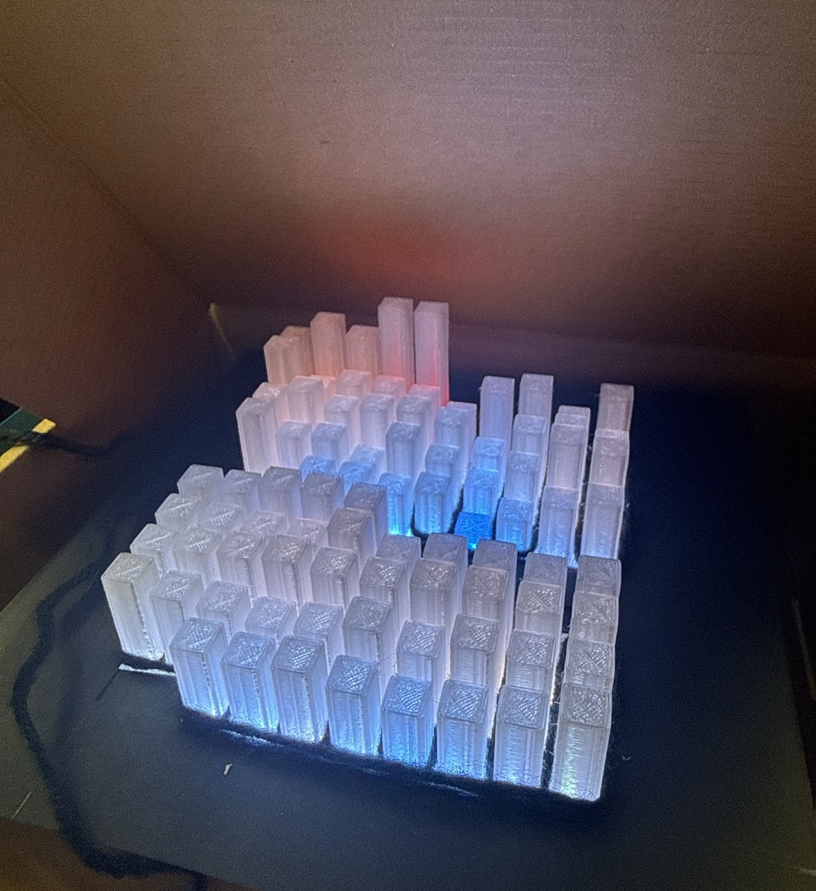
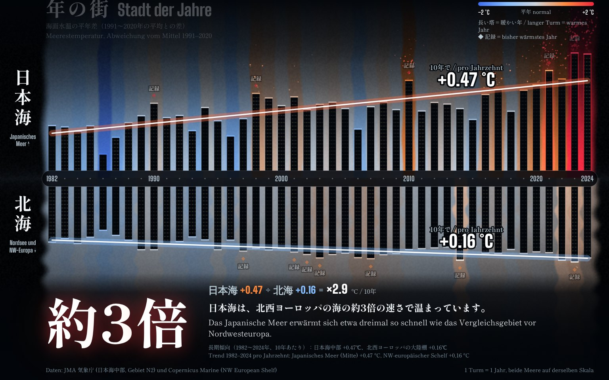
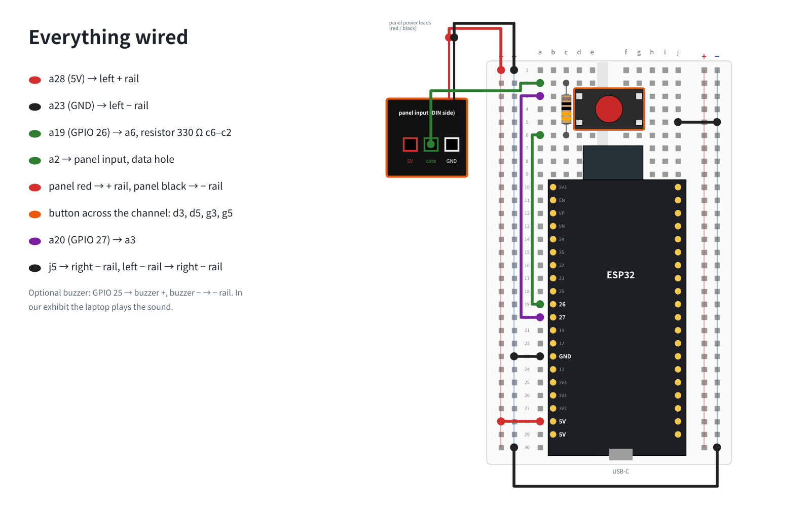

# 年の街 · Stadt der Jahre · City of Years

<p align="center">
  
  
</p>

**The Sea of Japan is warming almost three times as fast as the sea off northwestern Europe.**
City of Years makes that visible as a small city of light. Every tower is one year of sea surface temperature, from 1982 to 2024. Press the button and the city builds itself, year by year, on the object and on the screen at the same time, with sound.

Built in one week at **MUROS week 2026** at Meisei University in Tokyo, a project of Hochschule Düsseldorf and Meisei University. Every team paired a design student with a data scientist. Ours: **Ryoya** (design) and **Maurice Tay** (data, electronics, code).

## How it works

- **The object:** an ESP32 drives a 16 × 16 LED panel. A 3D-printed city sits on top, one tower per LED. Back block: Sea of Japan. Front block: northwestern European shelf, including the North Sea. Tower height and colour show how much warmer or colder the year was than the 1991–2020 average.
- **The button** starts a run: the panel goes dark and lights up again year by year, 1982 to 2024.
- **The page** in Chrome or Edge listens to the ESP32 over USB (Web Serial). It draws both cities on screen, plays a note per year and sea, and ends with the trend lines and the result. After that, five short scenes explain why, and what it means for fish and people.
- **The data** is the same in firmware and page, so object and screen always match.

| | Sea of Japan | NW European shelf |
|---|---|---|
| Trend 1982–2024 | **+0.47 °C** per decade | **+0.16 °C** per decade |
| Warming over the period | about +2.0 °C | about +0.7 °C |
| Record years since 1990 | 1990, 1998, 2010, 2021, 2023 | 1997, 2001, 2002, 2003, 2007, 2014, 2023 |

Ratio: 0.47 ÷ 0.16 ≈ **×2.9**. Reproduce it with `python data/trend.py`.

## Try it in one minute

No hardware needed: download [`web/stadt_der_jahre.html`](web/stadt_der_jahre.html), open it in Chrome or Edge and press **D** for the demo. **S** jumps to the conclusion scenes, **F** goes fullscreen. The file works offline.

## Build it

The [**handbook**](docs/HANDBOOK.md) walks through everything in ten illustrated steps: wiring, firmware, 3D print, exhibit and page. There is also a [printable PDF](docs/handbook/handbook.pdf).

<p align="center"></p>

## What is in here

```
firmware/stadt_der_jahre/   ESP32 code (Arduino, FastLED)
web/stadt_der_jahre.html    finished exhibition page, works offline
web/src/                    page source, map data and build script
print/                      the city as STL and the script that makes it
data/                       the 43 years as CSV, trend script, data swap script
docs/                       handbook, step pictures, photos
```

## Take it somewhere new

We would love to see this project go somewhere we did not think of. Not a polished copy of ours, but a different idea built on the same parts. A few starting points:

- **Your sea.** Copernicus Marine publishes the same kind of yearly anomaly series for other regions, for example the Iberia–Biscay–Ireland seas, and the JMA for every sea area around Japan. Put the numbers into `data/sst_annual_anomalies_1982_2024.csv`, run `data/apply_data.py`, rebuild the page and print a new city.
- **Another story, same city.** One tower per year works for any yearly series: rainfall, sea level, sea ice, the fish catch of your harbour.
- **Two cities, two countries.** The ESP32 has Wi-Fi. One object in Düsseldorf, one in Tokyo: press the button in one city and the other one lights up.
- **Your year.** Visitors enter their birth year and see how much the sea has changed during their own life.
- **Without a screen.** A version only for the ears, or towers you can touch, for people who cannot see the light.
- **Forward instead of back.** Add climate projections as pale ghost towers for the decades to come.
- **Other materials.** Glass, water, paper, wood: light behaves differently in each of them.

If you build something, open an issue or tag us. We want to see it.

## Where to change what

| You want to change | Look here |
|---|---|
| the numbers | `data/sst_annual_anomalies_1982_2024.csv`, then `data/apply_data.py` |
| speed, brightness, colours of the object | top of `firmware/stadt_der_jahre/stadt_der_jahre.ino` |
| tower height, fit on the panel | `print/make_grid.py` (`height()`, `POCKET`) |
| texts, scenes, sound of the page | `web/src/stadt_der_jahre.src.html`, then `python web/src/build.py` |
| maps in the conclusion | `web/src/make_maps.py` |

The page texts are in Japanese and German, as in our exhibition in Tokyo.

## Data and sources

- **Sea of Japan:** Japan Meteorological Agency (JMA), area-averaged sea surface temperature, area N2 (central Sea of Japan), yearly anomalies against 1991–2020. [JMA data page](https://www.data.jma.go.jp/gmd/kaiyou/data/shindan/a_1/japan_warm/japan_warm_data.html)
- **NW European shelf:** E.U. Copernicus Marine Service, ocean monitoring indicator `OMI_CLIMATE_SST_NORTHWESTSHELF_area_averaged_anomalies` (48–62° N, 18° W–13° E), monthly anomalies against 1991–2020, averaged per year by us. [Product page](https://data.marine.copernicus.eu/product/OMI_CLIMATE_SST_NORTHWESTSHELF_area_averaged_anomalies/description)
- **Conclusion scenes:** JMA (Sea of Japan conditions; 2024 sea surface temperature around Japan), Wu et al. (2012), *Nature Climate Change* (warming of western boundary currents), Ministry of Agriculture, Forestry and Fisheries of Japan (MAFF), Hokkaido Research Organization (HRO), Thünen Institute (fish in the North Sea), National Institute for Environmental Studies Japan (NIES), *Geophysical Research Letters* (marine heatwaves), IPCC AR6 Working Group I (2021).
- **Maps:** Natural Earth, public domain.


## Licence

- Code (firmware, page, scripts): MIT, see [LICENSE](LICENSE).
- Photos, handbook pictures and the STL: [CC BY 4.0](https://creativecommons.org/licenses/by/4.0/), credit "Ryoya & Maurice Tay, Stadt der Jahre".
- Data: by their sources above (JMA: Government of Japan Standard Terms of Use; Copernicus Marine: free use with attribution).
- Fonts embedded in the page: Shippori Mincho and Big Shoulders Display, SIL Open Font License.

## Thanks

To Kay Schröder (Hochschule Düsseldorf) and Takahito Kawahara (Meisei University) for MUROS week, and to every team for showing how differently one brief can be solved.
