# Handbook: build your own City of Years

From an empty breadboard to the glowing exhibit in ten steps. Every step has a picture; the wire colours in the text match the colours in the picture. A printable version of all pages is in [`handbook/handbook.pdf`](handbook/handbook.pdf).

## Parts

| Part | Notes |
|---|---|
| ESP32 dev board | We used the Freenove ESP32-WROOM (USB-C, CH340 chip). Any ESP32 works, just follow the pin labels. |
| LED panel | 16 × 16 WS2812B, flexible, 5 V |
| Breadboard | 830 holes |
| Push button | 12 × 12 mm, four legs |
| Resistor | 330 Ω |
| Jumper wires | about 8, male to male |
| USB-C cable | must carry data, not only power |
| 3D print | `print/stadt_der_jahre_grid.stl`, white or clear PLA |
| Laptop | with Chrome or Edge |
| Box | cardboard is fine, plus black paper |

Power comes from the laptop over USB. The firmware limits the LEDs to 900 mA so the board does not reset. With a separate 5 V supply (3 A or more) for the panel you can raise `POWER_MA` to 2500.

---

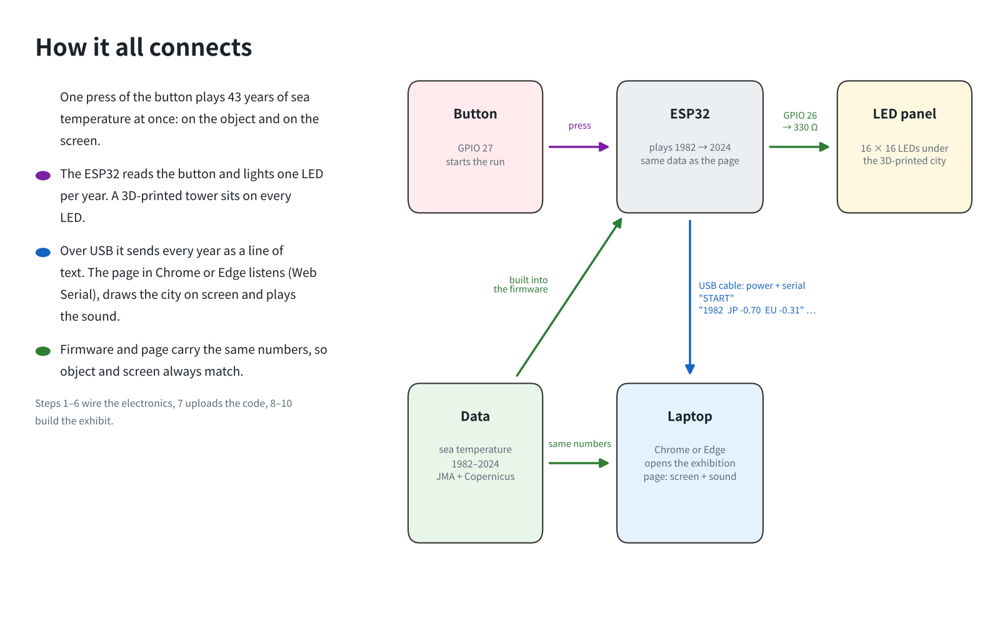

## 1 · ESP32 on the breadboard
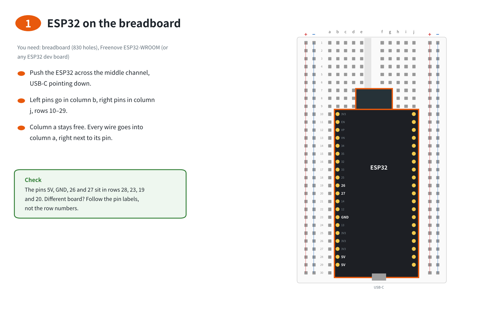
Push the ESP32 across the middle channel, USB-C pointing down: left pins in column b, right pins in column j, rows 10–29. Column a stays free for the wires.

## 2 · Power to the rails
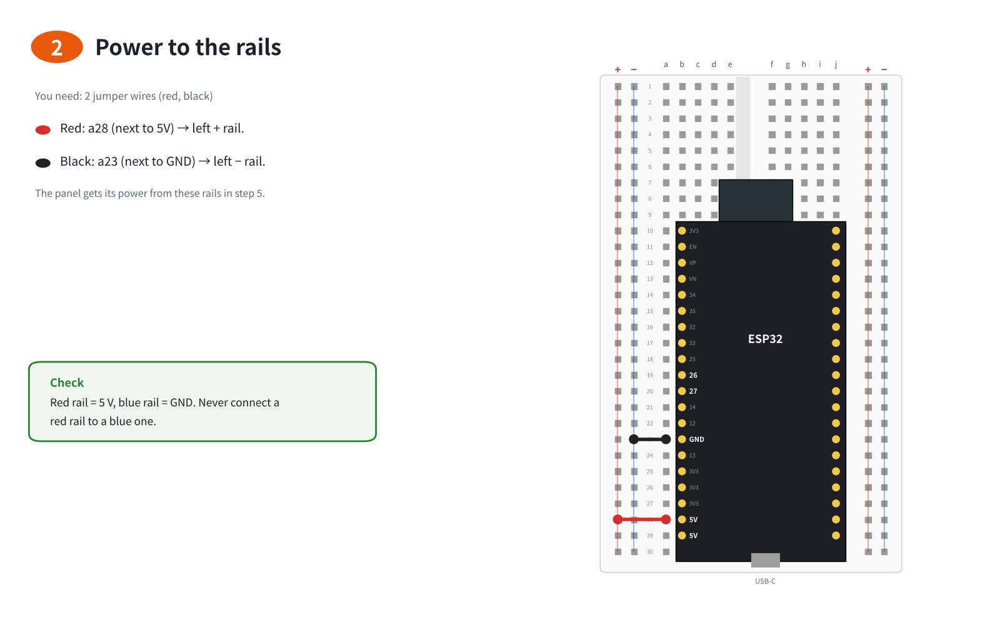
Red: a28 (5V) → left + rail. Black: a23 (GND) → left − rail.

## 3 · Data line with resistor
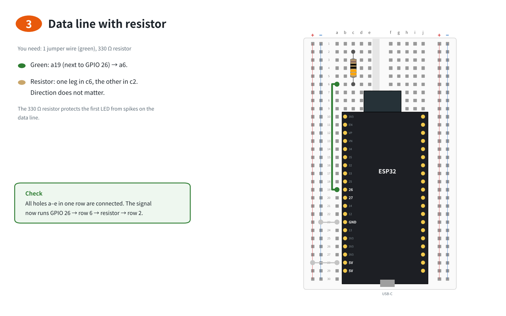
Green: a19 (GPIO 26) → a6. Resistor 330 Ω from c6 to c2.

## 4 · Find the panel input
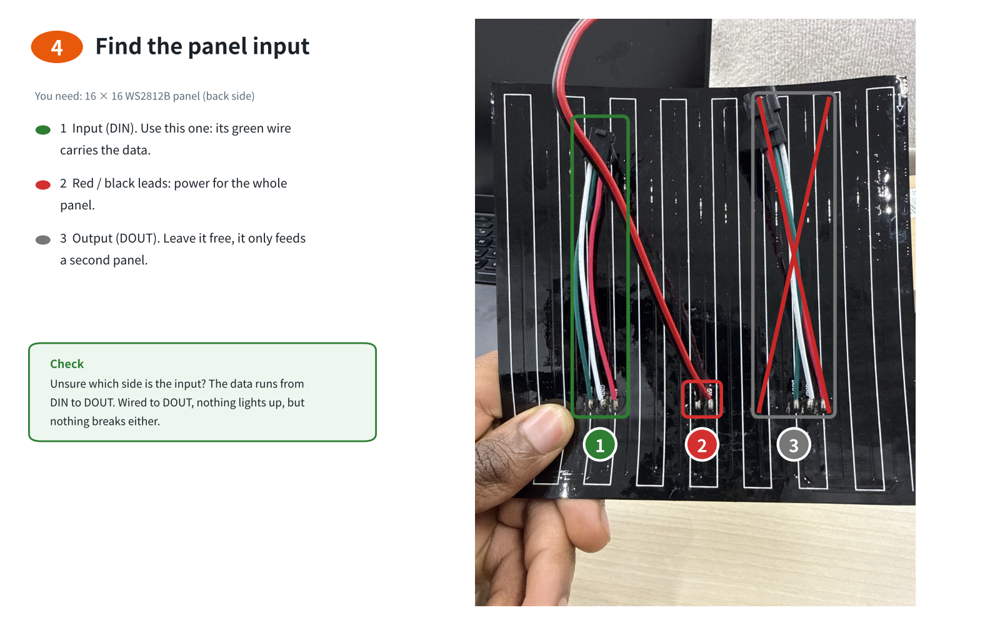
The panel has an input (DIN), power leads and an output (DOUT). Only the input and the power leads are used.

## 5 · Connect the LED panel
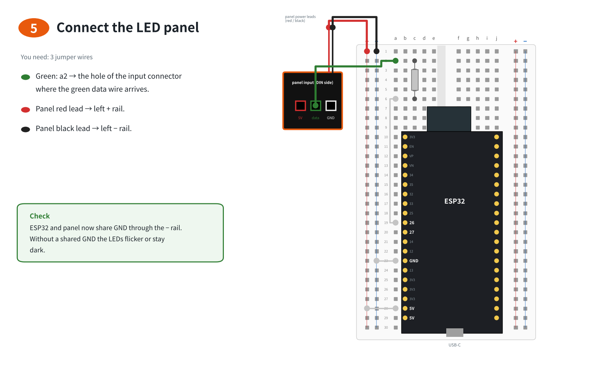
Green: a2 → data hole of the input connector. Panel red → + rail, panel black → − rail.

## 6 · The button
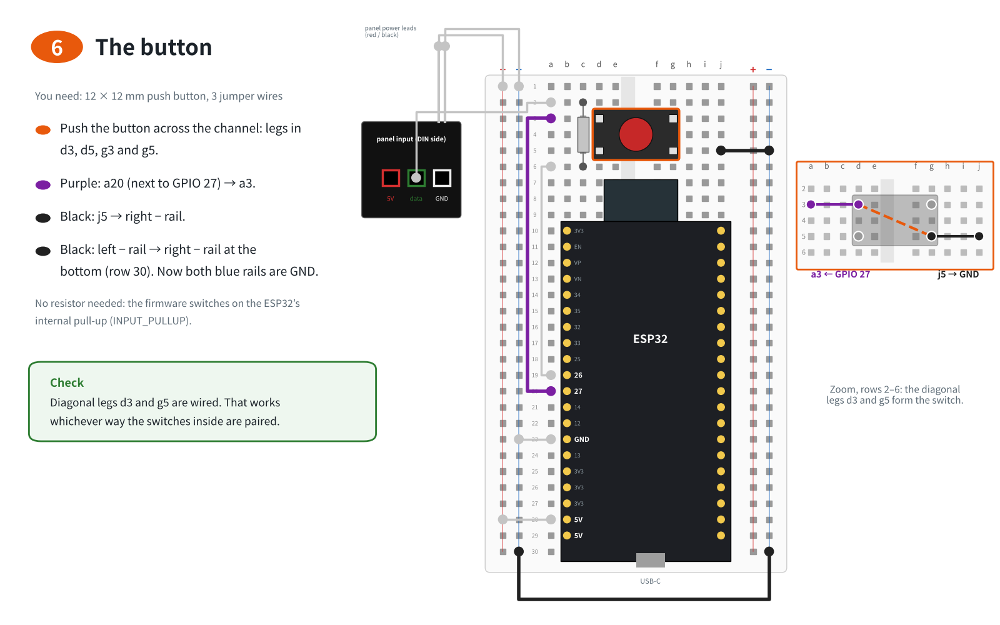
Button across the channel in d3, d5, g3, g5. Purple: a20 (GPIO 27) → a3. Black: j5 → right − rail, and left − rail → right − rail at row 30.

## 7 · Upload the firmware
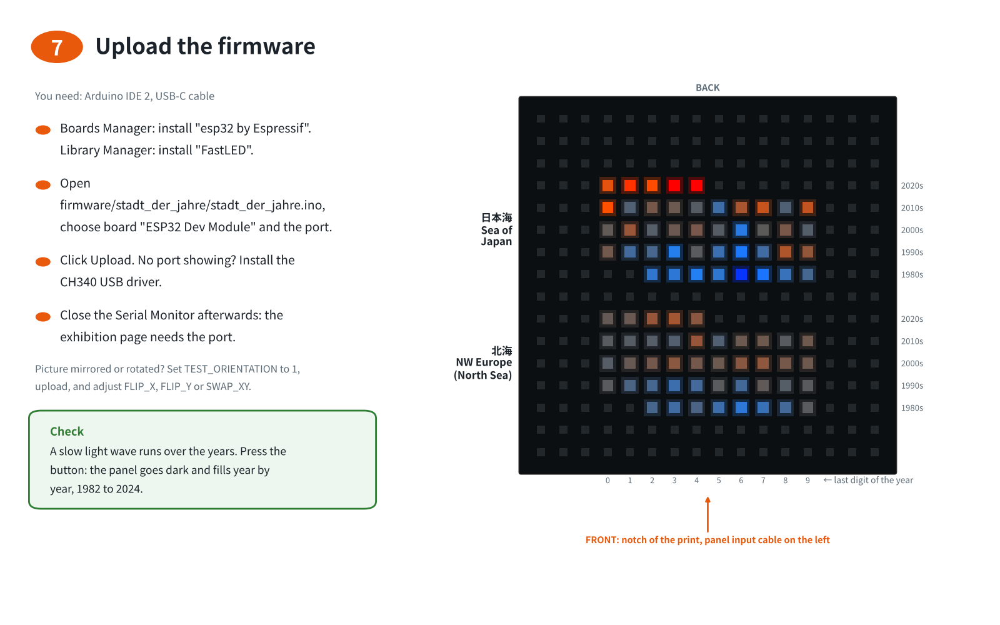
1. Arduino IDE 2 → Boards Manager → install **esp32 by Espressif**.
2. Library Manager → install **FastLED**.
3. Open `firmware/stadt_der_jahre/stadt_der_jahre.ino`, choose **ESP32 Dev Module** and the port, click Upload.
4. Close the Serial Monitor afterwards, the exhibition page needs the port.

Settings at the top of the file:

| Setting | Default | What it does |
|---|---|---|
| `BRIGHTNESS` | 255 | LED brightness |
| `POWER_MA` | 900 | current limit; 700 if the board restarts, 2500 with its own power supply |
| `MS_PER_YEAR` | 550 | time per year |
| `MS_LAST_DECADE` | 800 | slower for the 2020s, to build tension |
| `DECADE_PAUSE` | 500 | short pause before each new decade |
| `TEST_ORIENTATION` | 0 | 1 shows LEDs 0, 1, 15 and 16 to find the panel orientation |
| `SWAP_XY`, `FLIP_X`, `FLIP_Y`, `SERPENTINE` | | match the layout to your panel |

## 8 · Print the city
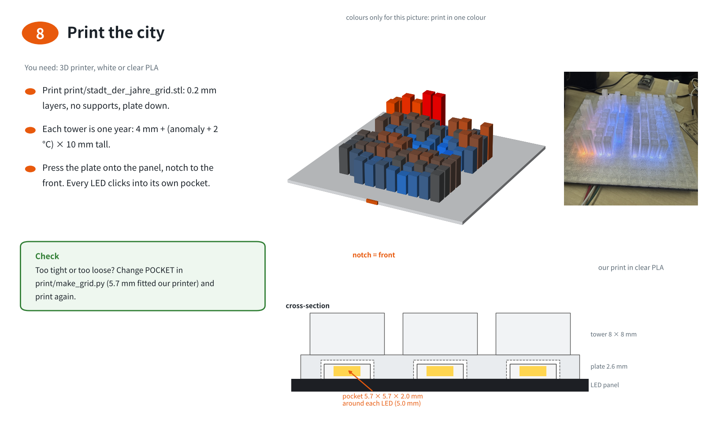
0.2 mm layers, no supports. The notch marks the front. The pockets in the underside hold the plate on the panel; if it is too tight or too loose, change `POCKET` in `print/make_grid.py` and print again.

## 9 · Set up the exhibit
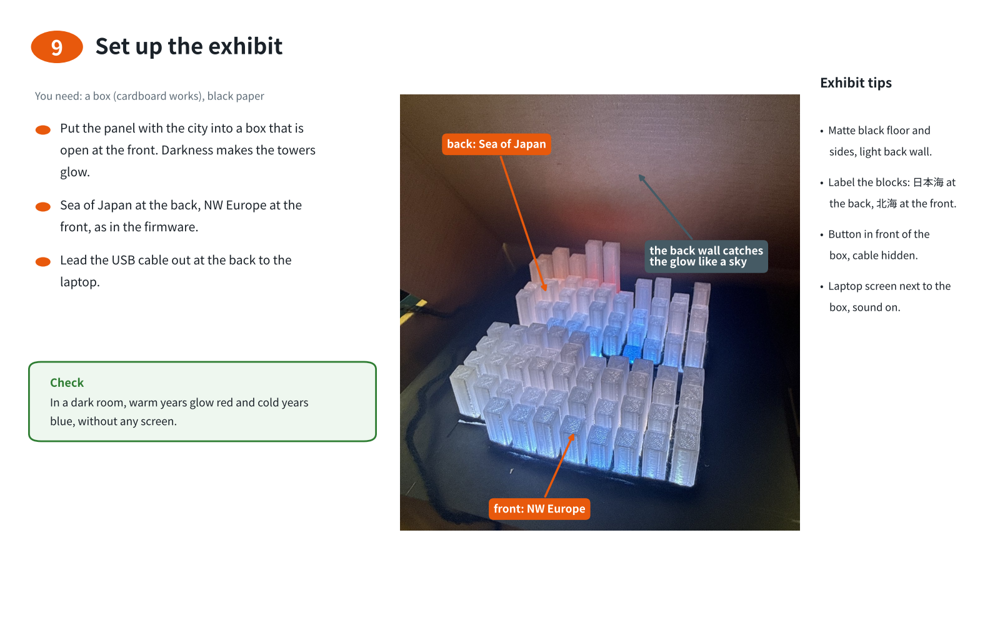

## 10 · Open the exhibition page
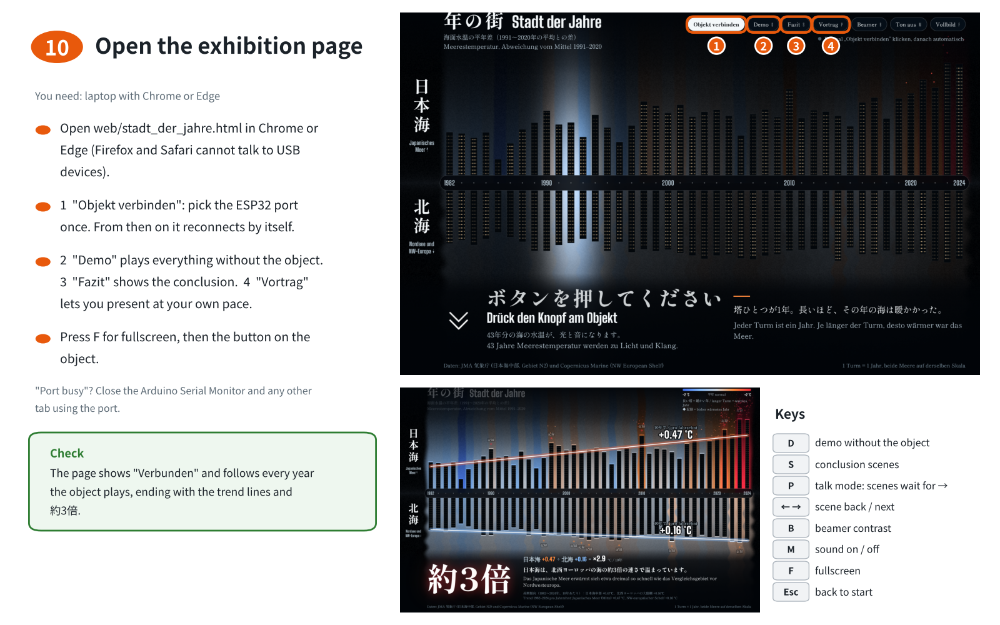
Open `web/stadt_der_jahre.html` in Chrome or Edge, click **Objekt verbinden** and pick the ESP32 port. From then on the page reconnects by itself. The page is bilingual (Japanese and German), like our exhibit in Tokyo.

## Everything at a glance
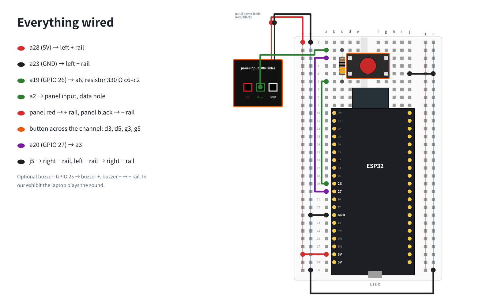

---

## When something does not work

| What you see | Cause and fix |
|---|---|
| Panel stays dark | Data wire on the output (DOUT) side, or ESP32 and panel do not share GND. Check steps 4 and 5. |
| LEDs flicker or show wrong colours | Missing resistor or loose data wire; also check the shared GND. |
| Board restarts in the middle of the run | Too much current over USB. Set `POWER_MA` to 700 or give the panel its own 5 V supply. |
| Picture is mirrored or rotated | Set `TEST_ORIENTATION` to 1 and adjust `SWAP_XY`, `FLIP_X`, `FLIP_Y`. |
| Button does nothing | The wires must reach diagonal legs (d3 and g5). a20 must be the hole next to GPIO 27. |
| Upload fails: port busy or PermissionError | The page or the Serial Monitor still holds the port. Close the tab or the monitor. |
| Page says "Bitte in Chrome oder Edge öffnen" | Firefox and Safari have no Web Serial. Use Chrome or Edge. |
| Page shows "Verbunden" but nothing happens | Press the button on the object. Still nothing? Close the Arduino Serial Monitor and reload the page. |
| No port in the Arduino IDE | Install the CH340 driver and use a USB cable that carries data. |
